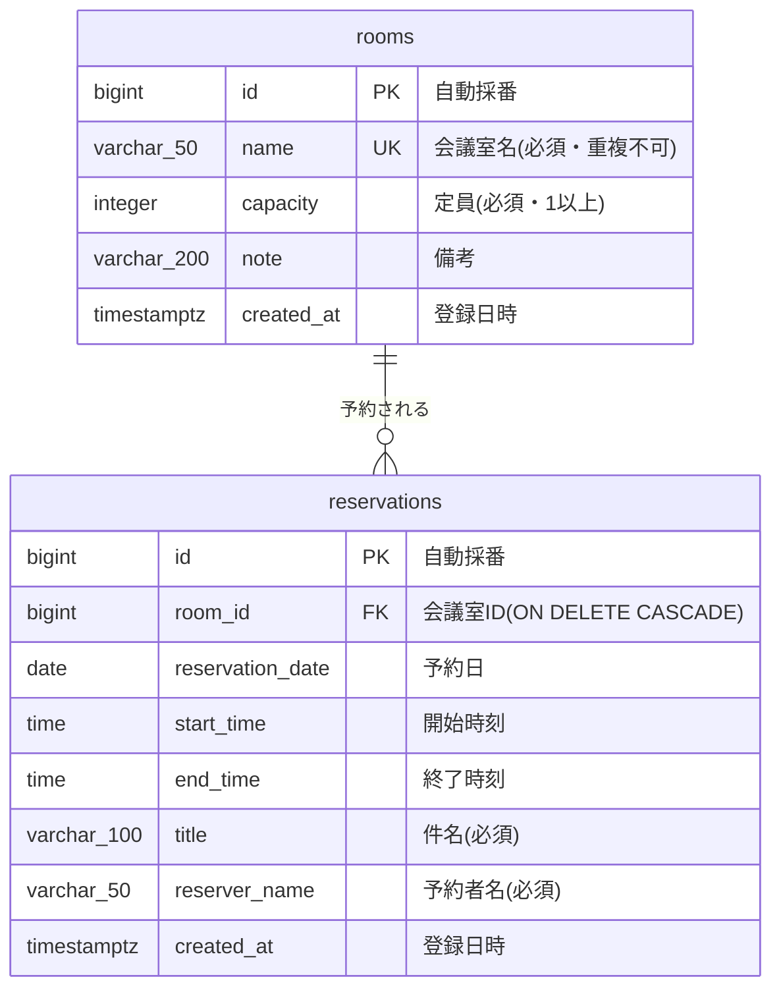

# 基本設計書 — 会議室予約システム

| 項目 | 内容 |
|---|---|
| 文書の位置づけ | 要件を「どういう画面・API・データ構造で実現するか」に落とし込む(外部設計) |
| 上位文書 | [02_要件定義.md](../../assignment/room/02_要件定義.md) |

## 1. システム構成

構成図は [../../images/architecture.png](../../images/architecture.png)(原本: [../../architecture.drawio](../../architecture.drawio))を参照。
SPA(React)+ REST API(Spring Boot)+ RDB(PostgreSQL)の3層構成。タスク管理と同一基盤で、backend は機能単位パッケージ `room/`(会議室)・`reservation/`(予約)を追加する。

## 2. 設計判断(要件定義「4. 基本設計に委ねる論点」)

### 採用方式サマリ

| 論点 | 採用 | 主な理由 |
|---|---|---|
| 2.1 重複判定 | Service で判定・半開区間(終了=開始は**重複しない**)・会議室行の悲観ロックで同時登録を直列化 | 連続会議を自然に入れられる。H2/PostgreSQL 両方で動く方式で整合性要件を満たせる |
| 2.2 予約時間の単位 | **15分単位**(UIはプルダウン、APIでも検証) | 会議の実態に合い、入力ミスを防げる。30分では短い打合せが不便 |
| 2.3 日時の持ち方 | **日付+開始時刻+終了時刻**(DATE / TIME)。日またぎは**不可** | 日別照会・重複判定のSQLが単純。タイムゾーン問題を避けられる |
| 2.4 画面の分け方 | **3画面(日別・会議室別・会議室管理)をタブで切替** | 要件 F-3-1 / F-3-2 の両方に素直に対応。ルーティングライブラリを追加せずに済む |

### 2.1 時間帯の重複判定

**(1) 境界の扱い**

| 案 | 内容 | メリット | デメリット |
|---|---|---|---|
| **A. 半開区間 [開始, 終了)(採用)** | 終了時刻=次の開始時刻は重複**しない** | 10:00〜11:00 の直後に 11:00〜12:00 を入れられる(連続会議の実態に合う) | 入れ替え時間が取れない(必要なら運用で調整) |
| B. 閉区間 [開始, 終了] | 終了時刻=次の開始時刻も重複**とする** | 入れ替え時間を強制できる | 11:00 終了の直後は 11:15 からしか取れず、空いているのに予約できないと感じる |

判定式(案A): `既存.開始 < 新規.終了 AND 新規.開始 < 既存.終了`(同一会議室・同一日付の予約が対象)。
→ 受入基準「同じ会議室の 11:00〜12:00」は **登録できる**。

**(2) 判定ロジックの置き場所**

| 案 | 内容 | メリット | デメリット |
|---|---|---|---|
| **A. Service で判定(採用)** | `ReservationService` が重なる予約の有無を Repository に問い合わせ、あれば 409 | ビジネスルールがService層に集まる(CLAUDE.md の層の責務どおり)。重なった既存予約をメッセージに含められる | 単体では同時登録の競合を防げない → (3) で補う |
| B. DB制約で判定 | PostgreSQL の排他制約(`EXCLUDE USING gist` + 範囲型) | DBが最終防衛線になり、競合も確実に防げる | **H2 で動かない**(DDLはH2互換で書くルールに反する)。エラーメッセージの組み立ても難しい |
| C. フロントで判定 | 取得済みの予約一覧と画面で比較 | 即時にフィードバックできる | 他人の最新予約を反映できず、APIを直接叩けば素通り。**単独では不可** |

**(3) 同時登録時の整合性**

| 案 | 内容 | メリット | デメリット |
|---|---|---|---|
| X. 対策なし | 判定→登録をそのまま実行 | 最も単純 | 2人がほぼ同時に登録すると両方通り得る。非機能要件「整合性」を満たさない |
| **Y. 会議室行の悲観ロック(採用)** | 予約登録トランザクションの最初に対象会議室を `SELECT … FOR UPDATE`(`@Lock(PESSIMISTIC_WRITE)`)で取得してから判定・登録 | 同じ会議室への登録だけが直列化され、別会議室は並行できる。H2 / PostgreSQL 両方で動く | ロック待ちが発生する(同時10名規模なので体感影響なし) |
| Z. トランザクション分離レベル SERIALIZABLE | DBにシリアライズ異常を検出させる | アプリの判定ロジックを変えずに済む | 失敗時のリトライ実装が必要。H2 と PostgreSQL で挙動差がありテストで再現しにくい |

### 2.2 予約時間の単位

| 案 | 内容 | メリット | デメリット |
|---|---|---|---|
| a. 任意の時刻 | 1分単位で自由入力 | 柔軟 | 10:07〜10:52 のような半端な予約が並び一覧が読みにくい。入力も手間 |
| **b-1. 15分単位(採用)** | 開始/終了とも 00・15・30・45 分のみ | 15分の立ち話・短い打合せにも対応でき、一覧も揃う | 選択肢が多い(1日96個) |
| b-2. 30分単位 | 00・30 分のみ | 選択肢が少なく操作が速い | 15分の打合せでも30分占有し、空き時間が無駄になる |

- 入力UI: 時刻は `<select>`(15分刻みの選択肢)で選ばせる。`<input type="time" step="900">` はブラウザにより刻み以外を手入力できてしまうため採用しない
- API でも「分が 15 の倍数かつ秒が 0」を検証し、違反は 400(UIを経由しない呼び出しへの備え)
- 選択可能な範囲は 00:00〜23:45(2.3 で日またぎ不可としたため、終了の上限は 23:45)

### 2.3 日時の持ち方

| 案 | 内容 | メリット | デメリット |
|---|---|---|---|
| **A. 日付+開始/終了時刻(採用)** | `reservation_date DATE`, `start_time TIME`, `end_time TIME`(Java は `LocalDate` / `LocalTime`) | 日別照会が `WHERE reservation_date = ?` で済む。重複判定も同一日付内の時刻比較だけ。タイムゾーン変換が発生しない | 日をまたぐ予約を表現できない |
| B. 開始/終了日時 | `start_at`, `end_at`(TIMESTAMP) | 日またぎ・長時間予約も表現できる | 日別照会が範囲検索になる(0時またぎの予約の扱いも必要)。timestamptz を使うとタイムゾーン変換の考慮が必要 |

- **日をまたぐ予約は許可しない**。会議室の夜間利用は想定されず、要件にもないため(必要になれば案Bへ移行するマイグレーションを追加する)
- 時刻はすべて日本時間(Asia/Tokyo)の壁時計時刻として扱う。「過去」の判定に使う現在時刻も Asia/Tokyo 基準とする

### 2.4 画面の分け方

| 案 | 内容 | メリット | デメリット |
|---|---|---|---|
| A. 1画面に全部 | 日別一覧・会議室別一覧・会議室管理・予約フォームを縦に並べる | タスク管理と同じ1画面構成で実装が最小 | 情報が多すぎて「空いている部屋」がすぐ分からない(要求の目的に反する) |
| **B. 3画面をタブで切替(採用)** | S-01 日別予約状況 / S-02 会議室別予約 / S-03 会議室管理 を画面上部のタブで切り替える(URLは `/` のまま、表示切替は state で行う) | 使う人ごとの目的(空き探し=社員、部屋の整理=総務)で画面が分かれる。**ライブラリ追加不要** | URLで画面を直接開けない(ブラウザの戻るで画面を戻れない) |
| C. 3画面を react-router で分割 | `/`, `/rooms/{id}`, `/admin/rooms` のようにURLを分ける | URL共有・戻る操作ができる | 新規ライブラリ追加が必要(承認が必要)。今回の規模では過剰 |

- 空き状況の見せ方は「会議室ごとの予約リスト」(表形式)とする。時間軸のタイムライン(グリッド)表示は見やすいが実装量が大きいため、発展要件の週表示とあわせて検討する

### 2.5 その他の判断(要件の解釈)

| 項目 | 判断 | 理由 / 代替案 |
|---|---|---|
| 「過去の日時」(F-2-4) | **開始日時が現在時刻より前**なら新規予約を拒否(400) | 進行中の時間帯に「今から」予約するケースは 15分単位の次の枠から取ってもらう |
| 「未来の予約」(F-1-4) | **終了日時が現在時刻より後**の予約(進行中を含む)があれば会議室削除を拒否(409) | 利用中の部屋が消えるのを防ぐ |
| 過去の予約しかない会議室の削除 | 会議室と一緒に過去予約も削除する(FK `ON DELETE CASCADE`) | 代替案の論理削除は会議室名の重複チェックが複雑になる。過去実績は発展要件(利用実績の集計)でのみ必要なため、今回は単純さを優先 |
| 予約の変更 | 提供しない(取り消して再登録) | 要件に変更機能がないため |
| 過去予約の取り消し | 制限しない | 要件で制限されていないため |

## 3. 画面設計

### 画面一覧

| 画面ID | 画面名 | パス | 概要 | 対応機能 |
|---|---|---|---|---|
| S-01 | 日別予約状況画面 | /(タブ) | 日付を選び、全会議室のその日の予約を一覧。予約登録・取り消しもここで行う | F-2, F-3-1 |
| S-02 | 会議室別予約画面 | /(タブ) | 会議室を選び、その会議室の予約を日時順に一覧。取り消しも可 | F-2-5, F-3-2 |
| S-03 | 会議室管理画面 | /(タブ) | 会議室の登録・一覧・編集・削除 | F-1 |

### 共通

| 項目/操作 | 内容 | 呼び出すAPI |
|---|---|---|
| ヘッダー | タイトルと画面切替タブ(日別 / 会議室別 / 会議室管理)。初期表示は日別 | — |
| エラー表示 | API失敗時、画面上部に `message` を表示(重複・削除不可もここに表示) | — |

### S-01 画面項目・アクション

| 項目/操作 | 内容 | 呼び出すAPI |
|---|---|---|
| 日付選択 | `<input type="date">`。初期値は今日。前日/翌日ボタン付き | A-06 |
| 予約状況一覧 | 全会議室を行として並べ、各会議室のその日の予約(開始〜終了・件名・予約者名)を開始時刻順に表示。予約のない会議室は「予約なし」と表示 | A-01, A-06 |
| 予約登録フォーム | 会議室(select)・日付(初期値は選択中の日付)・開始/終了時刻(15分刻みのselect)・件名・予約者名・登録ボタン。必須未入力の間はボタン非活性。登録成功で一覧を再取得 | A-09 |
| 取り消しボタン | 確認ダイアログ(`window.confirm`)後に予約を取り消す | A-10 |

### S-02 画面項目・アクション

| 項目/操作 | 内容 | 呼び出すAPI |
|---|---|---|
| 会議室選択 | 会議室の select | A-01 |
| 予約一覧 | 選択した会議室の予約を日付・開始時刻の昇順で表示(日付・開始〜終了・件名・予約者名) | A-07 |
| 取り消しボタン | S-01 と同じ | A-10 |

### S-03 画面項目・アクション

| 項目/操作 | 内容 | 呼び出すAPI |
|---|---|---|
| 登録フォーム | 会議室名(必須)・定員(必須・1以上)・備考(任意)・追加ボタン | A-03 |
| 会議室一覧 | ID昇順。会議室名・定員・備考 | A-01 |
| 編集ボタン | 行をフォーム表示に切り替え、保存で更新 | A-04 |
| 削除ボタン | 確認ダイアログ後に削除。未来の予約がある場合はエラー表示 | A-05 |

## 4. API設計

### API一覧

| API ID | メソッド | パス | 概要 | 正常時 | 対応機能 |
|---|---|---|---|---|---|
| A-01 | GET | /api/rooms | 会議室一覧取得(ID昇順) | 200 | F-1-2 |
| A-02 | GET | /api/rooms/{id} | 会議室1件取得 | 200 | — |
| A-03 | POST | /api/rooms | 会議室登録 | 201 | F-1-1 |
| A-04 | PUT | /api/rooms/{id} | 会議室更新 | 200 | F-1-3 |
| A-05 | DELETE | /api/rooms/{id} | 会議室削除(未来の予約があれば 409) | 204 | F-1-4 |
| A-06 | GET | /api/reservations?date={yyyy-MM-dd} | 指定日の全会議室の予約取得(会議室ID・開始時刻の昇順) | 200 | F-3-1 |
| A-07 | GET | /api/reservations?roomId={id} | 指定会議室の予約取得(日付・開始時刻の昇順) | 200 | F-3-2 |
| A-08 | GET | /api/reservations/{id} | 予約1件取得 | 200 | — |
| A-09 | POST | /api/reservations | 予約登録(重複があれば 409) | 201 | F-2-1〜F-2-4 |
| A-10 | DELETE | /api/reservations/{id} | 予約取り消し | 204 | F-2-5 |

- A-06 / A-07 は同一エンドポイントのクエリパラメータ違い。両方指定時は AND 条件、両方省略時は 400(全件取得の用途がないため)

### 入出力(会議室)

- リクエスト(A-03/A-04): `{ "name": string, "capacity": number, "note": string|null }`
- レスポンス: `{ "id": number, "name": string, "capacity": number, "note": string|null, "createdAt": string }`

### 入出力(予約)

- リクエスト(A-09): `{ "roomId": number, "date": "yyyy-MM-dd", "startTime": "HH:mm", "endTime": "HH:mm", "title": string, "reserverName": string }`
- レスポンス: `{ "id": number, "roomId": number, "roomName": string, "date": "yyyy-MM-dd", "startTime": "HH:mm", "endTime": "HH:mm", "title": string, "reserverName": string, "createdAt": string }`
  - `roomName` を含めるのは、画面側で会議室一覧と突き合わせずに表示できるようにするため

### エラー(共通)

`{ "message": string }` に統一(`GlobalExceptionHandler`)。

| ステータス | 発生条件 |
|---|---|
| 400 | 必須・文字数・数値範囲の違反、終了時刻が開始時刻以前、15分単位でない時刻、過去日時への予約、A-06/A-07 のパラメータなし |
| 404 | 対象の会議室・予約が存在しない(予約登録時の `roomId` 不在を含む) |
| 409 | 時間帯の重複(例: 「A会議室の 10:00〜11:00(定例会議)と時間が重なっています」)、会議室名の重複、未来の予約がある会議室の削除 |

- 409 はタスク管理にない区分のため、`common/` に競合用の例外(例: `ConflictException`)を追加して `GlobalExceptionHandler` で 409 に変換する(会議室・予約の2機能で共有するため common に置く)

各項目の型・必須・文字数などの詳細は Swagger UI(/api/docs)を正とする。

## 5. データ設計

### ER図

- 制約: `rooms.name` に UNIQUE、`rooms.capacity >= 1` と `reservations.start_time < end_time` に CHECK(アプリの検証に加えたDB側の防衛線。H2でも動く構文)
- インデックス: `reservations (room_id, reservation_date)`(重複判定・会議室別照会)、`reservations (reservation_date)`(日別照会)
- マイグレーション: `V2__create_rooms.sql`、`V3__create_reservations.sql`

カラムの詳細定義は 04_詳細設計.md のテーブル定義書を参照。

## 6. 処理方式

- **予約登録(A-09)** は `ReservationService` の1トランザクションで次の順に処理する
  1. 会議室を悲観ロック付きで取得(なければ 404)… 2.1(3) 案Y
  2. 開始日時が現在時刻より前なら 400 … 2.5
  3. 同一会議室・同一日付で `既存.開始 < 新規.終了 AND 新規.開始 < 既存.終了` の予約があれば 409 … 2.1(1)(2)
  4. 登録
- 入力チェックの置き場所: 必須・文字数・範囲・「終了>開始」・15分単位は DTO の Bean Validation(相関チェックは `@AssertTrue`)、現在時刻やDBの状態に依存するもの(過去日時・重複・会議室の存在・名前重複・削除可否)は Service
- 現在時刻は Asia/Tokyo の `Clock` から取得する(テストで時刻を固定できるようにするため)
- 会議室の更新・削除、予約の取り消しは単純更新とし、排他制御は行わない(同時利用10名規模のため。タスク管理の要件2.性能を踏襲)
- 一覧はページングなしで取得する(会議室は数十件、予約は日別・会議室別に絞り込むため件数が限られる)

## 7. 要件トレーサビリティ

| 要件 | 画面 | API | 備考 |
|---|---|---|---|
| F-1-1 会議室登録 | S-03 | A-03 | 名前重複は 409 |
| F-1-2 会議室一覧 | S-03 | A-01 | |
| F-1-3 会議室編集 | S-03 | A-04 | |
| F-1-4 会議室削除 | S-03 | A-05 | 未来の予約ありは 409(2.5) |
| F-2-1 予約登録 | S-01 | A-09 | |
| F-2-2 終了>開始 | S-01 | A-09 | 400 |
| F-2-3 重複予約の拒否 | S-01 | A-09 | 409。方式は 2.1 |
| F-2-4 過去日時の拒否 | S-01 | A-09 | 400(2.5) |
| F-2-5 予約取り消し | S-01, S-02 | A-10 | |
| F-3-1 日別予約状況 | S-01 | A-06(+A-01) | |
| F-3-2 会議室別予約一覧 | S-02 | A-07 | |
| 非機能: 整合性 | — | A-09 | 2.1(3) 悲観ロック |

## 8. 確認事項(発注者への確認待ち)

- 予約可能時間帯を 00:00〜23:45 としたが、業務時間(例: 8:00〜21:00)に絞るべきか
- 会議室削除時に過去の予約も削除する方針(2.5)で問題ないか(利用実績を残す必要があれば論理削除に変更)
