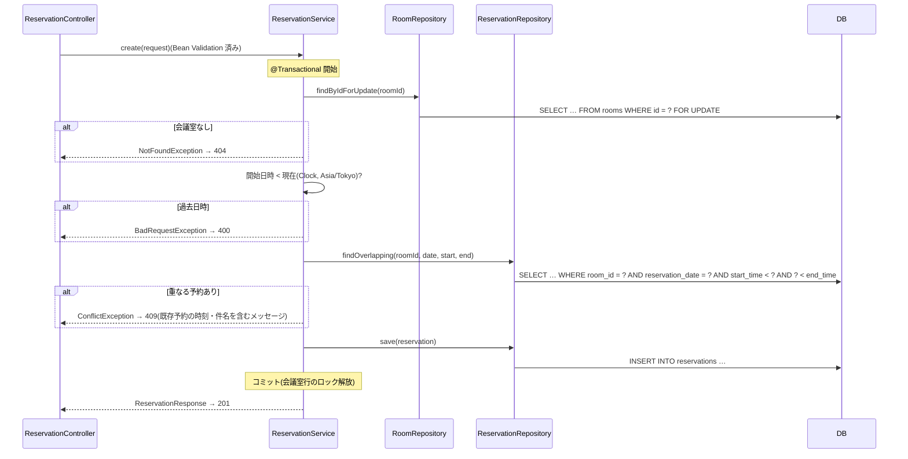

# 詳細設計書 — 会議室予約システム

| 項目 | 内容 |
|---|---|
| 文書の位置づけ | 実装の詳細を定める(内部設計)。ただし本プロジェクトの詳細設計は**薄く**保つ(方針は下記) |
| 上位文書 | [03_基本設計.md](./03_基本設計.md) |

## 0. 詳細設計の方針(重要)

**コード・テスト・自動生成物が正であり、この文書はそれらで表現できないものだけを持つ。**
日本語でコードを書き写す文書(クラス仕様書・処理フロー記述)は作らない。乖離した設計書は無いより有害である。

| 詳細設計の要素 | 正とするもの |
|---|---|
| API仕様の詳細 | Swagger UI(/api/docs)= springdocによる自動生成 |
| クラス構成・処理内容 | コードそのもの(構成規約は CLAUDE.md / architecture-guide.md) |
| 振る舞いの仕様 | テストコード(RoomApiTest / ReservationApiTest / App.test.tsx) |
| テーブル定義 | 本書 + Flywayマイグレーション(db/migration/) |
| 複雑な処理の流れ | 本書のシーケンス図(該当がある場合のみ) |

### 実装状況

| 機能 | 状況 |
|---|---|
| F-1 会議室マスタ管理(A-01〜A-05 / S-03) | 実装済み(A-05 の「未来の予約があれば409」を含む) |
| F-2 予約登録(A-08・A-09 / S-01 の登録フォーム) | 実装済み。ただし F-2-5 予約取り消し(A-10)は取り消しボタンを予約一覧に置くため、F-3 と合わせて実装する |
| F-3 予約照会(A-06・A-07 / S-01 の予約一覧・S-02) | 未実装。S-01 は現在、登録フォームと登録完了メッセージのみ |

## 1. テーブル定義書

### rooms(会議室)

| カラム | 型 | NULL | 既定値 | 説明 |
|---|---|---|---|---|
| id | BIGINT (IDENTITY) | 不可 | 自動採番 | 主キー |
| name | VARCHAR(50) | 不可 | — | 会議室名。重複不可(一意制約 `uq_rooms_name`) |
| capacity | INTEGER | 不可 | — | 定員。1以上(CHECK制約 `chk_rooms_capacity`) |
| note | VARCHAR(200) | 可 | — | 備考。NULLは未入力 |
| created_at | TIMESTAMP WITH TIME ZONE | 不可 | CURRENT_TIMESTAMP | 登録日時 |

- 対応マイグレーション: `V2__create_rooms.sql`(定義。初期データなし)
- インデックス: 主キー、一意制約 `uq_rooms_name` のインデックス

### reservations(予約)

| カラム | 型 | NULL | 既定値 | 説明 |
|---|---|---|---|---|
| id | BIGINT (IDENTITY) | 不可 | 自動採番 | 主キー |
| room_id | BIGINT | 不可 | — | 会議室ID。rooms.id への外部キー `fk_reservations_room`(ON DELETE CASCADE) |
| reservation_date | DATE | 不可 | — | 予約日 |
| start_time | TIME | 不可 | — | 開始時刻(15分単位) |
| end_time | TIME | 不可 | — | 終了時刻(15分単位)。開始時刻より後(CHECK制約 `chk_reservations_time`) |
| title | VARCHAR(100) | 不可 | — | 件名 |
| reserver_name | VARCHAR(50) | 不可 | — | 予約者名 |
| created_at | TIMESTAMP WITH TIME ZONE | 不可 | CURRENT_TIMESTAMP | 登録日時 |

- 対応マイグレーション: `V3__create_reservations.sql`(定義。初期データなし)
- インデックス: 主キー、`idx_reservations_room_date (room_id, reservation_date)`(重複判定・会議室別照会)、`idx_reservations_date (reservation_date)`(日別照会)
- 時間帯の重複はDB制約ではなく `ReservationService` で判定する(基本設計 2.1。H2で動く構文に限るため)

## 2. バリデーション仕様

| 対象 | ルール | 実装箇所 |
|---|---|---|
| name(会議室) | 必須(空白のみ不可)、50文字以内。前後の空白を除いた値で登録し、他の会議室と同じなら409(更新時は自分自身を除いて判定) | RoomRequest(Bean Validation)+ `RoomService`(重複確認)。DB側も一意制約で保証 |
| capacity | 必須、1以上の整数。整数以外(文字列等)はリクエスト形式不正として400 | RoomRequest(Bean Validation)+ `Integer`(型変換)。DB側もCHECK制約で保証 |
| note | 任意、200文字以内。前後の空白を除き、空なら NULL として登録 | RoomRequest(Bean Validation)+ `RoomService` |
| フロント側(会議室) | 会議室名が空・定員が1以上の整数でない間は追加/保存ボタン非活性、maxLengthで文字数制限 | RoomForm.tsx |
| roomId / date / startTime / endTime | 必須。date は `yyyy-MM-dd`、時刻は `HH:mm`。形式不正(`25:00` 等)はリクエスト形式不正として400 | ReservationRequest(Bean Validation)+ Jackson(型変換) |
| startTime / endTime(単位) | 分が15の倍数かつ秒が0(`10:10`・`10:00:30` は400) | ReservationRequest(`@AssertTrue`) |
| endTime(相関) | 開始時刻より後(同時刻も400) | ReservationRequest(`@AssertTrue`)。DB側もCHECK制約で保証 |
| title / reserverName | 必須(空白のみ不可)、100文字 / 50文字以内。前後の空白を除いた値で登録 | ReservationRequest(Bean Validation)+ `ReservationService` |
| 開始日時(過去) | 日本時間の現在時刻より前なら400(現在ちょうどは可) | `ReservationService`(`Clock` から現在時刻を取得) |
| 会議室の存在 | 存在しない roomId は404 | `ReservationService` |
| 時間帯の重複 | 同一会議室・同一日付で `既存.開始 < 新規.終了 AND 新規.開始 < 既存.終了` の予約があれば409(終了=開始は重複しない) | `ReservationService` + `ReservationRepository.findOverlapping` |
| 会議室の削除可否 | 終了日時が現在より後(進行中を含む)の予約があれば409 | `RoomService` + `ReservationRepository.existsNotFinished` |
| フロント側(予約) | 会議室・日付・開始/終了時刻・件名・予約者名のいずれかが未入力の間は予約ボタン非活性。時刻は15分刻みの select、maxLengthで文字数制限。終了>開始・過去日時・重複はAPIのメッセージを表示 | ReservationForm.tsx |

## 3. 例外・トランザクション方針

- 対象が存在しない場合は Service で `NotFoundException` を送出し、`GlobalExceptionHandler` が404 + `{"message"}` に変換する
- バリデーション違反は同ハンドラが400 + `{"message"}` に変換する
- リクエスト本文が読めない場合(JSON不正、`capacity` に数値以外など。`HttpMessageNotReadableException`)も同ハンドラが400 + `{"message"}` に変換する
- パスパラメータの型不一致(`/api/rooms/abc` など。`MethodArgumentTypeMismatchException`)も同ハンドラが400 + `{"message"}` に変換する
- 会議室名の重複・予約時間帯の重複・未来の予約がある会議室の削除は Service で `ConflictException`(common)を送出し、同ハンドラが409 + `{"message"}` に変換する
- 過去日時への予約は Service で `BadRequestException`(common)を送出し、同ハンドラが400 + `{"message"}` に変換する(DTOだけでは判定できない400のため)
- 現在時刻は `ClockConfig` の `Clock`(Asia/Tokyo)から取得する。テストは `FixedClockConfig` で 2026-11-02 10:00 に固定する
- トランザクション境界は Service(クラスに `@Transactional(readOnly = true)`、更新系メソッドに `@Transactional`)
- 予約登録は会議室行の悲観ロック(`RoomRepository.findByIdForUpdate`。`@Lock(PESSIMISTIC_WRITE)` = `SELECT … FOR UPDATE`)で同じ会議室への登録を直列化する(基本設計 2.1(3))
- 会議室の更新・削除は排他制御を行わない(基本設計 6. 処理方式)

## 4. シーケンス図

会議室マスタ管理には複雑な処理が存在しないため、対象なし。

### 予約登録(A-09)

同じ会議室への登録を悲観ロックで直列化してから判定・登録する。後から来たトランザクションはロック待ちになり、先の登録がコミットされた後に重複判定するため、重なる予約が2件確定することはない(非機能要件「整合性」)。

